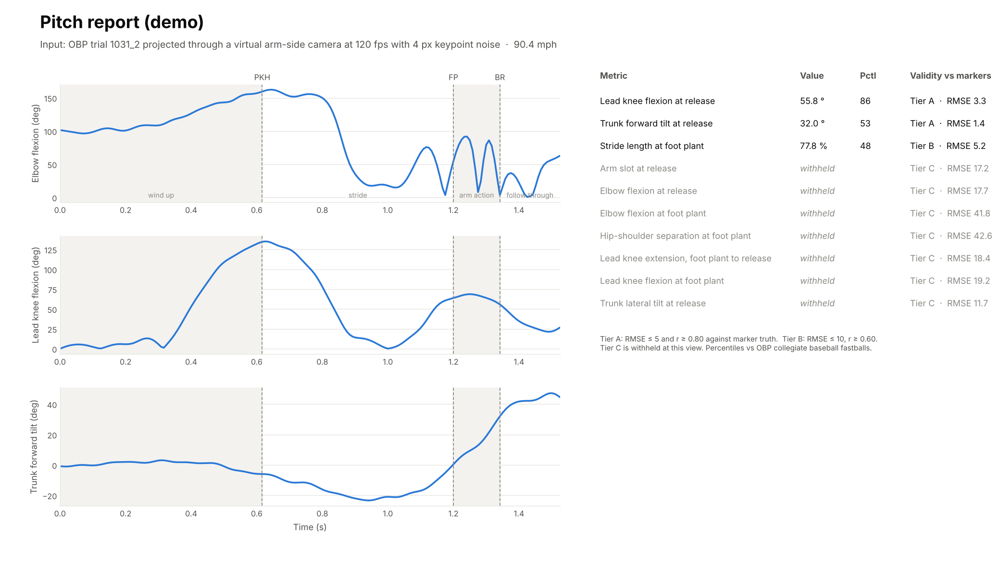
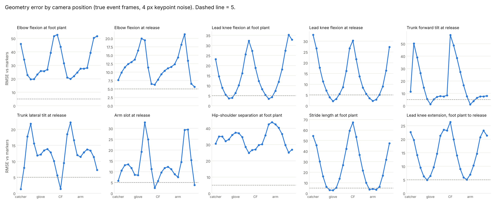
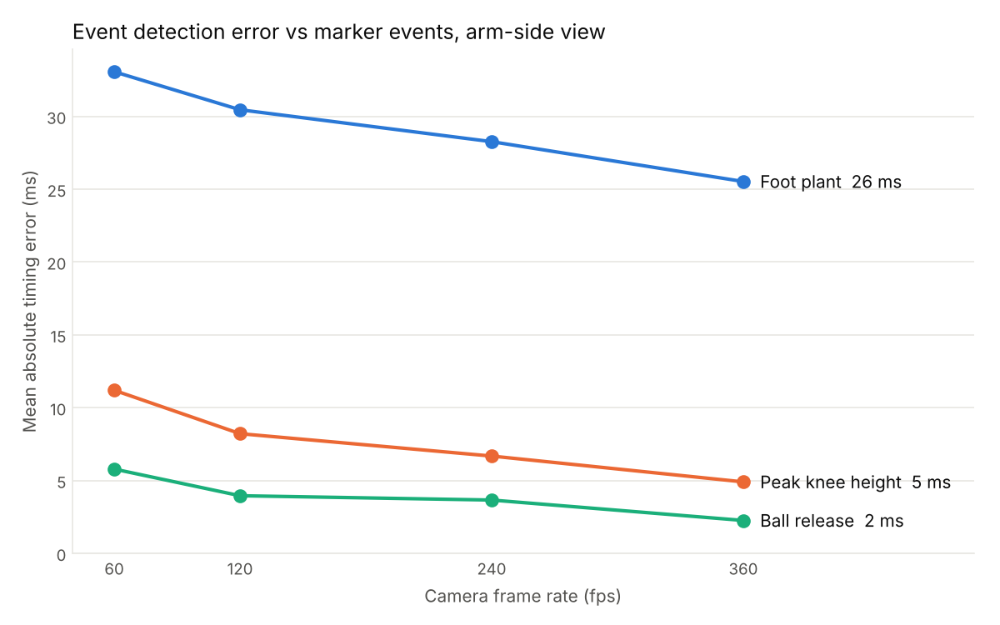
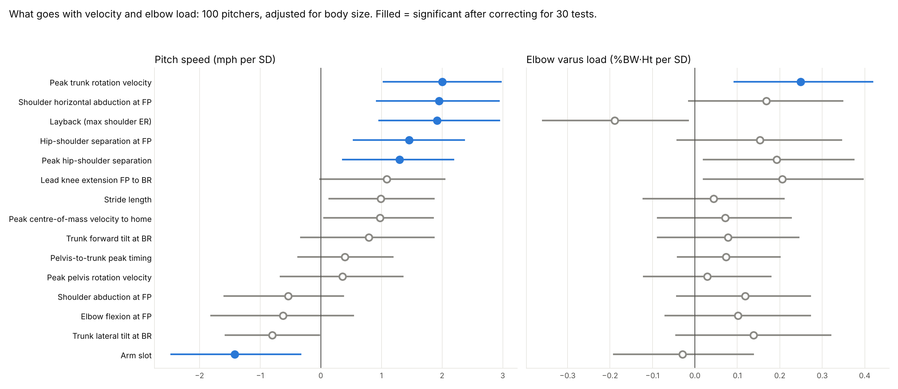
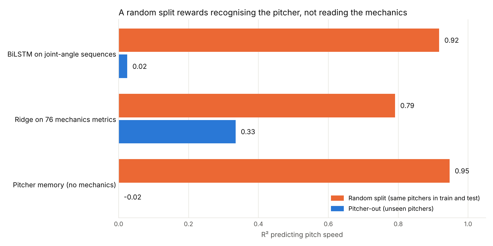

# PitchLab

Pitching biomechanics from a single camera, checked against marker-based motion capture.

A phone on a tripod can give coaches a lot of mechanics, but only some of what it gives is right. PitchLab takes a pitching video, finds the key moments of the delivery, measures joint angles, and then reports only the metrics that a camera at that position can actually measure. Every metric carries a validity tier that was earned against marker data, and anything that failed the check is withheld with the reason instead of being shown as a number.

The repo also contains the two analyses that sit around the pipeline: which mechanics go with velocity and elbow load, and a check of how a common deep-learning setup can look accurate for the wrong reason.

All numbers below come from the scripts in this repo and can be reproduced with `make all`.



## Data

[OpenBiomechanics](https://github.com/drivelineresearch/openbiomechanics) (Driveline Baseball), `dataset-v1`: 411 fastballs from 100 pitchers, recorded with marker-based motion capture at 360 Hz with force plates. The data is licensed CC BY-NC-SA 4.0 and is **not** included here. `scripts/01_get_data.sh` downloads it and checks the files against Driveline's published SHA-256 sums.

Eighteen trials have event labels that are not physically possible (release before foot plant, or a missing force-plate event). They are removed with fixed bounds set before any model was run, which leaves **393 pitches from 98 pitchers** for the camera and sequence studies. The driver study uses all 411 pitches averaged to 100 pitchers.

This is baseball overhand data. The pipeline also runs on fastpitch softball windmill deliveries, but there is no marker dataset for windmill here, so softball output comes without percentiles and with a note that it is descriptive only.

## What is in it

| Study | Question | Script |
|---|---|---|
| A. Drivers | Which mechanics go with pitch speed and with elbow load, once body size is accounted for? | `scripts/02_biomech_drivers.py` |
| B. Single camera | How much error does one camera add, and which metrics survive it at each camera position? | `scripts/03_projection_study.py` |
| C. Leakage | How much of a velocity model's accuracy comes from recognising the pitcher rather than reading the mechanics? | `scripts/04_sequence_leakage.py` |
| Pipeline | Video in, gated report out | `scripts/analyze_video.py` |

### Study B: what one camera can and cannot measure

The 3D marker positions for every pitch are projected through a virtual phone camera (1920×1080, 10 m away, lens at 1.2 m) placed at 24 positions around the mound. Each 2D metric is then compared with the same metric computed from the 3D markers. The end-to-end test adds 4 px of keypoint noise, drops the frame rate to what a real camera records, and detects the events from the 2D keypoints instead of using the lab's labels. The release-timing offset is learned on other pitchers only (GroupKFold by pitcher).

Arm-side view, 120 fps, detected events, 393 pitches:

| Metric | RMSE vs markers | 95% CI (pitcher bootstrap) | r | Tier |
|---|---|---|---|---|
| Trunk forward tilt at release | 1.4° | 1.2–1.6 | 0.99 | A |
| Lead knee flexion at release | 3.3° | 2.9–3.8 | 0.98 | A |
| Stride length at foot plant | 5.2 % height | 4.6–5.7 | 0.79 | B |
| Trunk lateral tilt at release | 11.7° | 9.3–14.1 | 0.40 | C |
| Arm slot at release | 17.2° | 15.1–19.3 | 0.34 | C |
| Elbow flexion at release | 17.7° | 16.4–19.1 | 0.32 | C |
| Lead knee flexion at foot plant | 19.2° | 15.4–22.7 | 0.12 | C |
| Elbow flexion at foot plant | 41.8° | 36.3–47.3 | 0.33 | C |
| Hip-shoulder separation at foot plant | 42.6° | 40.3–44.8 | 0.03 | C |

Tier A: RMSE ≤ 5 and r ≥ 0.80. Tier B: RMSE ≤ 10 and r ≥ 0.60. Tier C is not reported.

What this means in practice:

- **Each camera position measures different things.** From the side (arm side or glove side), trunk forward tilt, lead knee at release and stride length hold up. From behind the plate or from center field, trunk lateral tilt is tier A (1.5° and 1.4°) and arm slot is tier B from the catcher view, but the side-view metrics fall apart. A two-camera setup (side plus behind) covers more than any single angle.
- **Hip-shoulder separation is not measurable from one camera at any of the four standard positions**, even with perfect keypoints and perfect timing. It is a rotation about the vertical axis, and a single image flattens it. Any single-camera tool that reports it as a number should be treated with caution.
- **Elbow flexion fails because the forearm points at or away from the camera** during the arm action, so its length in the image collapses.
- **Foot plant is the hardest event to time.** At 120 fps the mean error is 4 ms for release, 8 ms for peak knee height and 30 ms for foot plant from the arm side (19 ms from the glove side). Metrics taken at foot plant inherit that error, which is why lead knee at foot plant fails while lead knee at release passes.




Event timing, mean absolute error in ms (4 px noise):

| View | Event | 60 fps | 120 fps | 240 fps | 360 fps |
|---|---|---|---|---|---|
| Arm side | Release | 5.8 | 4.0 | 3.7 | 2.3 |
| Arm side | Peak knee height | 11.2 | 8.2 | 6.7 | 4.9 |
| Arm side | Foot plant | 33.1 | 30.4 | 28.3 | 25.5 |
| Glove side | Release | 8.5 | 3.8 | 3.0 | 2.7 |
| Glove side | Foot plant | 22.1 | 18.7 | 17.0 | 15.1 |

The tiers for every view are saved in `configs/measurability.json`, and the pipeline reads that file to decide what to show.

### Study A: what goes with velocity and elbow load

Each pitcher's pitches are averaged first, so the unit is the pitcher (n = 100), not the pitch. For each of 15 mechanics chosen in advance, the model is `outcome ~ mechanic + body mass + height` on standardised values. Confidence intervals come from 2,000 pitcher bootstrap samples, p-values from 5,000 permutations, and Benjamini-Hochberg correction across all 30 tests.

Pitch speed (mean 84.7 mph, SD 4.8), effects significant after correction:

| Mechanic | mph per 1 SD | 95% CI | q |
|---|---|---|---|
| Peak trunk rotation velocity | +2.0 | 1.0 to 3.0 | 0.002 |
| Shoulder horizontal abduction at foot plant | +1.95 | 0.9 to 2.9 | 0.002 |
| Layback (max shoulder external rotation) | +1.9 | 1.0 to 2.9 | 0.002 |
| Hip-shoulder separation at foot plant | +1.5 | 0.5 to 2.4 | 0.004 |
| Arm slot | −1.4 | −2.5 to −0.3 | 0.012 |
| Peak hip-shoulder separation | +1.3 | 0.4 to 2.2 | 0.021 |

Elbow varus moment (normalised to body weight × height, mean 6.8 %BW·Ht): only peak trunk rotation velocity survives correction (+0.25 %BW·Ht per SD, q = 0.021). Faster pitchers do load the elbow more (r = 0.32, 95% CI 0.17–0.46 after normalising for body size; r = 0.47 in raw N·m).

These are associations across pitchers, not cause and effect. The two strongest velocity mechanics that a single camera could deliver (hip-shoulder separation and layback) are both ones that Study B shows a single camera cannot measure, which is a useful thing to know before building a product around them.



### Study C: a random split rewards recognising the pitcher

A BiLSTM reads 45 joint-angle channels from peak knee height to release and predicts pitch speed. It is scored two ways: a random 5-fold split, where the same pitcher's other pitches are in training, and a pitcher-out split (GroupKFold), where the test pitchers are never seen. Hyper-parameters were fixed before any run. Three seeds.

| Model | Random split R² | Pitcher-out R² | Pitcher-out MAE |
|---|---|---|---|
| BiLSTM on joint-angle sequences | 0.92 | 0.03 | 3.6 mph |
| Ridge on 76 OBP mechanics metrics | 0.79 | 0.34 | 2.9 mph |
| Pitcher memory (average of that pitcher's other pitches) | 0.95 | −0.02 | 3.8 mph |

A model that knows nothing about mechanics, only who the pitcher is, scores best on the random split. The BiLSTM looks excellent on a random split and has almost no skill on new pitchers, where a simple ridge model on summary metrics does clearly better. For any model meant to be used on new athletes, the split has to be by athlete.



## Pipeline

```
video ─► BlazePose (33 landmarks) ─► canonical keypoints (throwing / lead side)
      ─► 12 Hz low-pass ─► events: peak knee height, foot plant, ball release
      ─► metrics at each event ─► gate by measurability tier for this camera view
      ─► percentile vs OBP (baseball overhand only) ─► JSON + dashboard PNG
```

- **Peak knee height**: highest point of the lead knee in the image.
- **Ball release**: peak throwing-wrist speed after knee lift, plus a per-view offset learned on OBP.
- **Foot plant**: after the lead ankle's fastest point, the first frame where its speed drops below 15 % of that peak, searched before release.

The demo at the top of this page is OBP trial 1031_2 projected through the arm-side camera at 120 fps with noise, then run through the same code a video would use. It reports the three metrics that passed and withholds the rest.

## Run it

```bash
python -m pip install -r requirements.txt
make data        # download and verify OBP (about 70 MB)
make test        # 31 tests; data tests skip if the data is missing
make all         # studies A, B, C and the figures (about 10 minutes on a laptop CPU)
```

Analyse your own clip (MediaPipe downloads its pose model on first use):

```bash
python scripts/analyze_video.py clip.mp4 --throws R --view arm_side
python scripts/analyze_video.py clip.mp4 --throws R --view glove_side --style windmill
```

For best results: tripod, 120 fps or higher, camera roughly level with the hips, the whole body in frame from set position to follow-through, and one pitch per clip.

## Repo layout

```
pitchlab/
  data.py         OBP loaders, left-handers mirrored to right-handed
  geometry.py     joint angles and tilts, shared by 3D and 2D code
  camera.py       virtual pinhole camera and the four named views
  metrics.py      each metric defined twice: from markers and from pixels
  events.py       filtering and 2D event detection
  validation.py   geometry sweep, end-to-end test, tiers
  sequence.py     BiLSTM, ridge and pitcher-memory models
  report.py       light-mode figures and the dashboard
  video/          pose estimation, keypoint mapping, the full pipeline
configs/          measurability tiers, percentile norms, release offsets (all generated)
scripts/          01 data, 02–05 studies and figures, analyze_video.py
results/          CSV and JSON outputs and figures
tests/            pytest suite
docs/METHODS.md   definitions and design choices in more detail
```

## Limits

- The camera study uses projected marker positions plus noise, not real phone video of the same pitches. Real pose-estimation error on a pitching arm is likely larger than 4 px around release, so the tiers are an upper bound on what a phone can do. A paired video-and-marker check is the next step.
- All validation is on baseball fastballs from one lab. Softball windmill, other pitch types and youth athletes are not covered by the tiers or the norms.
- Study A is cross-sectional and observational.

## Credits and licence

Code: MIT (see `LICENSE`). Data: OpenBiomechanics by Driveline Baseball, CC BY-NC-SA 4.0. Results and figures derived from it are shared under the same terms. If you use the data, cite Driveline as described in their [CITATION.cff](https://github.com/drivelineresearch/openbiomechanics).

Faizan Khan, University of Virginia.
